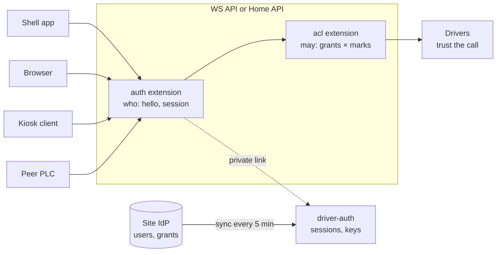

# 01 — Access and security at a glance

> Written ahead of the code, from the design in [`design/evok-node/13a`](../dev/design/evok-node/13a-Auth-and-ACL.md). Not implemented yet.

## 1. How it fits together



Every call passes the same two steps before any driver sees it: **who** is calling, then **may** they do this.

## 2. Who can call

| Who | How they prove it |
|---|---|
| a person in the shell app | logs in at the site IdP once; each PLC then opens its own session |
| a person in a browser | the PLC runs the IdP login and sets a secure cookie |
| a wall panel, a kitchen tablet | its own key, enrolled once by QR in the Inspector |
| another PLC | its node key, both sides proving themselves |

Nothing is anonymous. A **guest** is a normal IdP user with a PIN and few rights; disable the account after the visit.

## 3. What they may do

A **role** is a group in the IdP with a grants attribute. Members of a group also get the grants of its parent groups.

```jsonc
// group "resident"
{ "evok": { "v": 1, "grants": [{ "privilege": "operate", "scope": "zone:common" }] } }
// group "tenant:flat3", parent "resident"
{ "evok": { "v": 1, "grants": [{ "privilege": "manage", "scope": "zone:flat3" }] } }
```

| Privilege | Allows |
|---|---|
| `view` | see devices and values |
| `operate` | switch, set, move |
| `manage` | change settings, devices, rooms and groups of a home driver |
| `administer` | zones, users, remotes, raw drivers, node config |

Each includes the ones before it.

| Scope | Covers |
|---|---|
| `site` | everything on every PLC |
| `node:house` | everything on the PLC `house` |
| `zone:flat3` | home devices in rooms of zone `flat3` and of zones below it |
| `device:house/home:device.local.12` | one device |

- Grants only add up; the highest one wins, and there is no "deny". Draw boundaries with zones.
- A flat that needs its own manager gets its own home driver; the others import its devices.
- Some actions ask for more than a grant — see §4.

## 4. Levels and proof

| Level | Reached by |
|---|---|
| `l1` | password, a refreshed session, the PIN |
| `l2` | phone key with Face ID or fingerprint, a passkey, a login with MFA |

Opening a door, a gate or a garage door needs a **proof for that one call**, on top of the session:

- **biometry** on the phone, or a passkey in a browser;
- **the PIN** — it identifies the person, so a guest or anyone at a wall panel can open the door;
- **a confirmation tap**, only within 5 minutes after biometry.

A rule may open a door on its own (for example at 7:00) only if its author was at `l2` when writing it.

## 5. Sessions

| | Lives |
|---|---|
| access token | 10 min, renewed automatically |
| session on a PLC | 30 days idle, 30 days at most |
| offline login (IdP down) | one connection, 12 h at most |

**When the IdP is down:** open sessions keep working, and so do proofs. A new session is possible with the PIN, or with a phone already registered on that PLC.

## 6. Admin checklist

| Task | Where |
|---|---|
| one `evok` app for the whole site; add each PLC's `https://<name>/auth/callback` to its redirect list | IdP |
| groups with `evok.grants` for every role | IdP |
| a service account per PLC, `evok.nodeKey` = the key shown in the Inspector; `evok.delegate: true` if it relays users' calls to other PLCs | IdP |
| a service account per wall panel, `evok.clientKeys` from its enrolment | IdP |
| PINs: 6 digits or more, unique across the site | IdP |
| `nodeId` (unique in the site), `mode: site`, the IdP issuer, the sync API token | each PLC, `driver-auth` config |
| one HTTPS name per PLC, its own certificate (Let's Encrypt, DNS-01), the same name at home through local DNS | DNS, each PLC |
| zones on rooms | Inspector or Home UI |

With no site IdP, the PLC is its own IdP: users, PINs, panels and peer PLCs are managed in its Inspector.
